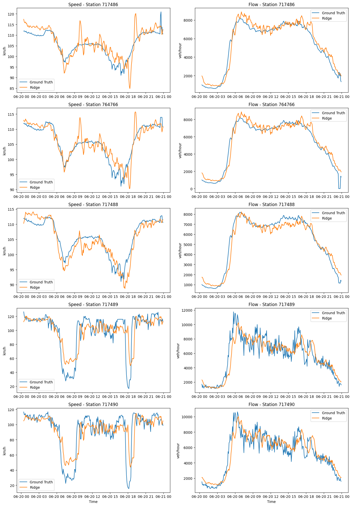

# Short-Term Traffic Forecasting with Physics-Based and Hybrid Models

Graduate research for COMP 841 investigating traffic flow and speed forecasting with a **Cell Transmission Model (CTM)**, **Temporal Ridge Regression (TRR)**, and **hybrid residual learning**. The study considers nominal **5-, 15-, and 30-minute prediction horizons** using historical measurements from five traffic stations.

The research asks whether a statistical model can improve a physics-based forecast by learning its systematic errors. Short-term traffic prediction provides useful context for transportation planning and autonomous systems operating in changing traffic conditions. This repository is a research prototype in Python/Jupyter and MATLAB, with saved experiments and comparative evaluations.

**My contributions:** Python TRR implementation, temporal and multi-station feature engineering, ridge-based residual-learning experiments, and comparative evaluation of flow and speed forecasts. **A research colleague implemented the original MATLAB CTM.** The work combines numerical modeling, time-series feature construction, regularized machine learning, and analysis of model performance across stations.

## Model architecture

All three approaches predict station-level flow and speed, but use measurements differently:

| Model | Inputs and approach | Role in the study |
|---|---|---|
| CTM (MATLAB) | Traffic measurements initialize a discretized conservation model with a triangular fundamental diagram; demand and supply constrain flow between cells. | Physics-based forecast baseline. |
| TRR (Python) | Historical flow and speed across five stations form standardized lag features; separate multi-output ridge regressions predict future flow and speed. | Standalone statistical forecast. |
| Hybrid CTM + TRR (Python) | Ridge regressions use the lag features to learn the difference between observations and supplied CTM forecasts. Predicted corrections are added to CTM outputs. | Investigates whether learned corrections improve physics-based forecasts. |

For either flow or speed, the hybrid formulation is:

$$r_{t+h}=y_{t+h}-\hat y^{CTM}_{t+h}, \qquad
\hat y^{hybrid}_{t+h}=\hat y^{CTM}_{t+h}+\hat r_{t+h}(X_t).$$

During training, observations and CTM predictions define the residual targets. At inference, the residual model uses measured history to estimate a correction to the CTM forecast. The standalone TRR instead predicts the target directly from the same type of history. Correct station and forecast-target alignment is necessary for both training and evaluation.

The saved Python configuration uses flow and speed at lags 0–5 across five stations: **60 features**, including the current measurement and five preceding rows. On a regular five-minute grid, these inputs span 25 minutes. Separate ridge penalties for flow and speed are selected through four expanding-window date folds. A persistence baseline predicts that each station's current measurement remains unchanged.

## Experiments and originally reported results

The supplied detector extracts are described in the original documentation as US-101 data. Training covers eight observed dates in June 2005; testing covers June 20–22. The notebooks use separate training and test files. The original data acquisition and extraction procedure is not included.

`DELTA = 1, 3, 6` represents nominal 5-, 15-, and 30-minute horizons. The saved fitted notebook evaluations below use `DELTA = 6`. Other horizon comparisons appear as manually entered plotting arrays, rather than a complete saved automated sweep. Row shifts cross missing records and date gaps, so six rows ahead is not always 30 minutes of elapsed time.

These are **originally reported results**, preserved in the saved [TRR notebook](TRR_Hybrid_models_code/AItrafficFlowTRR.ipynb) and [hybrid notebook](TRR_Hybrid_models_code/AItrafficFlowHybrid.ipynb). Metrics are means of the five per-station RMSEs, rather than pooled RMSE.

| Model | Test forecast origins | Flow RMSE (veh/h) | Speed RMSE (km/h) |
|---|---:|---:|---:|
| Standalone TRR | 837 | 818.91 | 8.19 |
| Hybrid CTM + TRR | 833 | 799.50 | 9.89 |
| Persistence | 837 | 880.31 | 8.79 |

**The hybrid demonstrated lower reported flow RMSE than standalone TRR, while standalone TRR was preferable for speed prediction in the original comparison.** TRR also had lower average flow and speed RMSE than persistence on their shared evaluation, although it did not outperform persistence at every station.

The original hybrid and TRR scores use different subsets, and CTM export alignment remains unresolved. Their reported ranking is therefore an experimental finding with qualifications, rather than a verified comparison on identical targets. No standalone CTM RMSE is presented as a validated future-target score; see the limitations below and the [research audit](docs/RESEARCH_AUDIT.md).

### Supplementary external validation — artifacts pending inclusion

A separate, externally conducted Python reconstruction of CTM forecasts and residual learning was reported to yield approximately **819.00 veh/h** flow RMSE for standalone TRR and **802.81 veh/h** for the reconstructed hybrid on the same **833 test observations**, an approximately **1.98% reduction**.

Supporting reconstruction scripts and outputs are **not present in this repository**. These supplementary figures have not been independently verified from the checked-in artifacts and are pending inclusion; they are separate from the original saved notebook results. The reported improvement is specific to that experiment and does not establish generalization to other datasets or traffic conditions.

## Example predictions



Saved TRR notebook output for June 20, 2005: speed on the left and flow on the right. The x-axis shows forecast-origin timestamps; targets are six rows ahead. This figure was extracted from saved output without rerunning the experiment. The hybrid notebook's analogous plot uses standalone TRR prediction variables despite its legend; it should not be treated as evidence of hybrid trajectories.

## Repository navigation

| Location | Contents |
|---|---|
| [TRR notebook](TRR_Hybrid_models_code/AItrafficFlowTRR.ipynb) | Feature engineering, ridge tuning, standalone forecasts, persistence comparison, and saved results. |
| [Hybrid notebook](TRR_Hybrid_models_code/AItrafficFlowHybrid.ipynb) | Residual learning from supplied CTM exports and model comparisons. |
| [Python guide](TRR_Hybrid_models_code/README.md) | Input filenames, working directory, and execution details. |
| [Python requirements](TRR_Hybrid_models_code/requirements.txt) | Pinned numerical, machine-learning, plotting, and Jupyter dependencies. |
| [MATLAB CTM](MATLAB%20Code%20CTM/README.md) | Colleague's calibration, simulation, and forecasting implementation with detector inputs. |
| [Research audit](docs/RESEARCH_AUDIT.md) | Evidence for saved metrics, alignment findings, and detailed methodological considerations. |
| [Archive](archive/README.md) | Historical notebook variants; use the current notebooks above as entry points. |

`TRR_Hybrid_models_code/` includes the detector training/test CSVs, a CTM training export, and CTM test exports labeled D1, D3, and D6. The original training-export procedure is absent; the checked-in MATLAB scripts do not generate the residual-learning CSVs end to end.

## Running the Python notebooks

The existing setup documentation specifies Python 3.12. From the repository root:

```bash
python3.12 -m venv .venv
source .venv/bin/activate
python -m pip install -r TRR_Hybrid_models_code/requirements.txt
cd TRR_Hybrid_models_code
jupyter lab
```

On Windows PowerShell, activate with `.venv\Scripts\Activate.ps1`. Open `AItrafficFlowTRR.ipynb` first, then `AItrafficFlowHybrid.ipynb`, and select the environment's Python kernel. Run cells from top to bottom. Launching Jupyter from this directory allows the notebooks' relative CSV paths to resolve. Saved outputs can also be inspected without execution.

The requirements already include NumPy, pandas, SciPy, scikit-learn, Matplotlib, seaborn, JupyterLab, Notebook, and ipykernel. No additional Python dependency is prescribed here. The hybrid notebook reads the supplied CTM CSVs; rerunning the original MATLAB exporter is not an available prerequisite. Changing the hybrid horizon requires a matching test export and verification of the unversioned training export's horizon and timestamp semantics.

These instructions reflect the checked-in setup and notebook imports. A fresh environment installation and full notebook execution were not performed for this README update, so end-to-end reproducibility is not established. For MATLAB prerequisites and known execution issues, consult the [MATLAB guide](MATLAB%20Code%20CTM/README.md).

## Limitations and next steps

- **CTM evaluation alignment:** The original MATLAB RMSE calculation compares forecasts against current observations rather than the corresponding future observations. This is a scoring alignment issue; it does not by itself establish that forecast generation is incorrect. Python CTM export timestamps and station labels also require verification before a controlled comparison.
- **Reproducibility and provenance:** Saved notebooks and input CSVs support inspection of the original results, but the missing training-export procedure leaves CTM input provenance unresolved. Supplementary reconstruction artifacts, original data extraction details, and complete automated horizon experiments remain to be included.
- **Temporal validation and consistency:** Preprocessing is fitted before cross-validation rather than within each fold, shifted targets are not purged at fold boundaries, and elapsed horizons are not enforced across gaps. Python and MATLAB also use slightly different mph-to-km/h conversions. Future evaluation should resolve these issues and compare all models on identical station/target pairs.
- **Scope:** A small detector extract and short temporal holdout limit conclusions. CTM's simplified traffic assumptions and linear residual correction may not capture all congestion dynamics. Additional roads, seasons, and traffic regimes are needed to assess generalization.

The study illustrates the potential of combining traffic physics with learned corrections, with a flow-versus-speed tradeoff in the original comparison. Recovering export provenance and completing aligned evaluation are the next steps toward stronger experimental conclusions.
